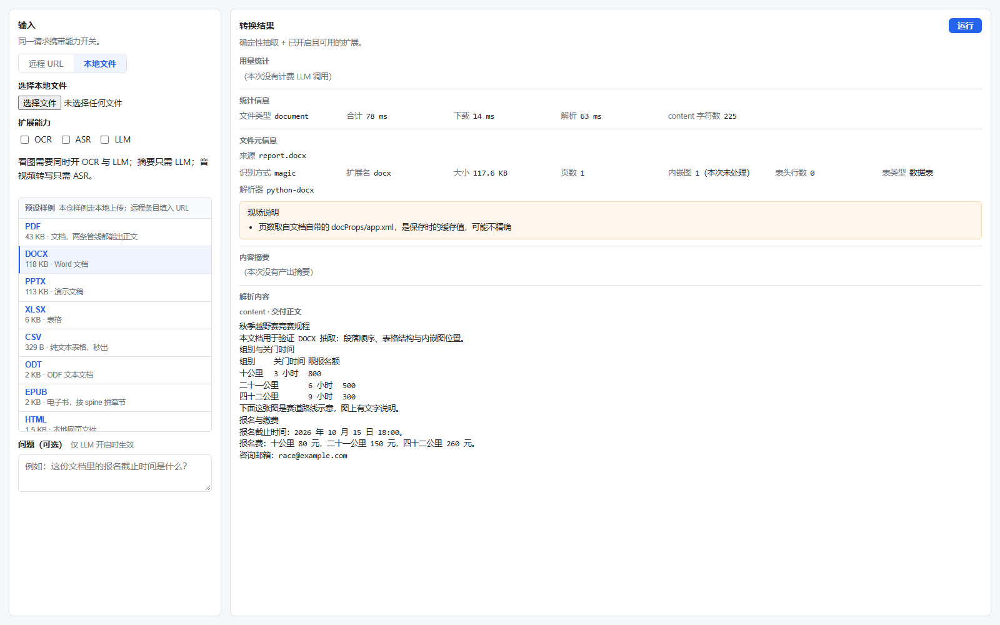
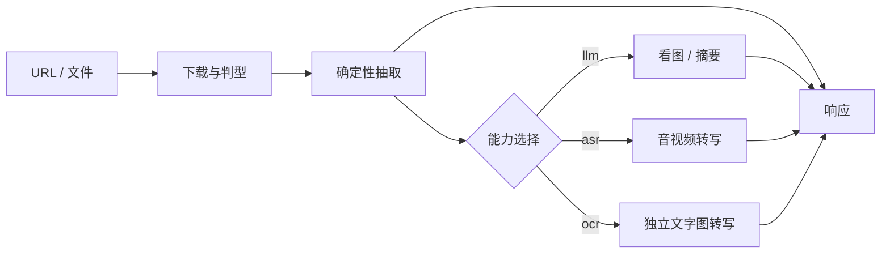

# anyurl2text

**把任意 URL 或本地文件，转成尽可能保留原始信息的文本或摘要。**

确定性抽取 · OCR 读图 · ASR 转写 · LLM 摘要

[项目介绍](#项目介绍) · [快速开始](#快速开始) · [怎么工作](#怎么工作) · [接口用法](#接口用法) · [项目结构](#项目结构) · [许可与第三方](#许可与第三方)

---

## 项目介绍

网页、PDF、表格、截图、录音、视频——各自有合适的读法。只靠规则能抽出文档正文；要读图上的字、听清音视频里说了什么、再做摘要，就需要接上 OCR、ASR 和 LLM。

anyurl2text 用一条统一接口 `POST /convert` 完成这件事：先把 URL 或文件落成临时文件，再按类型抽取。图片、音视频依赖 OCR / ASR 增强；摘要依赖 LLM。LLM 与工作流节点是调用场景；产物是原始文本或摘要。

### 项目包含什么

| 能力 | 做什么 | 缺了怎样 |
|---|---|---|
| 确定性抽取 | PDF / Office / 网页 / 表格等按格式出正文 | **核心**。只装后端依赖就能跑这一层 |
| OCR | 独立图片的文字转写（模型视觉 / 本机 Paddle 二选一） | 独立文字图几乎只剩结构信息。扫描件与内嵌图走 LLM，不看这一项 |
| ASR | 音视频转写成文字 | 只有时长等结构信息 |
| LLM | 摘要、按问题回答；图片判型、语义描述、扫描页与内嵌图转写 | 不能摘要、不能看图 |
| Web 界面 | 选源、开开关、看结果 | 本机调试用；没有界面仍可直接调接口 |

仓库：https://github.com/moyezq/anyurl2text （镜像：https://gitee.com/osc_74795964/anyurl2text）  
许可证：[MIT](LICENSE)  
仓库**不收录** OCR / ASR 模型权重，需自行下载到对应服务目录，或接其它同类服务。

---

## 快速开始

命令默认在**仓库根目录**执行。

### Ⅰ 安装并跑通核心

需要：uv、Python ≥ 3.12（由 uv 管理）、Node.js ≥ 18。

**安装 uv**

```powershell
# Windows
powershell -ExecutionPolicy ByPass -c "irm https://astral.sh/uv/install.ps1 | iex"
```

```bash
# macOS / Linux
curl -LsSf https://astral.sh/uv/install.sh | sh
```

装完后新开终端，确认 `uv --version`、`node -v`。

**拿到代码并装依赖**

```powershell
git clone https://github.com/moye233057/anyurl2text.git
cd anyurl2text

copy .env.example .env   # macOS / Linux: cp .env.example .env

uv sync
cd frontend
npm install
cd ..
```

`.env` 从 `.env.example` 复制而来。**需要专门填写的只有 `DEEPSEEK_API_KEY`**（不填则 LLM / 看图不可用，文档类抽取不受影响）。其余项文件里已有注释和默认值，要改端口、超时、限额时打开那份看即可。

此时即可做**文档类确定性抽取**。一键拉起前后端：

```powershell
uv run python start.py
```

| 入口 | 地址 |
|---|---|
| 前端 | http://127.0.0.1:5173 |
| 接口文档 | http://127.0.0.1:8020/docs |

也可分开起：后端 `cd backend` 后 `uv run uvicorn app:app --host 127.0.0.1 --port 8020`；前端 `cd frontend` 后 `npm run dev`。Ctrl+C 停止 `start.py` 会一并收掉子进程。

### Ⅱ 配齐扩展（推荐）

核心能抽文档；要覆盖截图、扫描件、音视频和摘要，把下面三项配上。

**1. LLM（摘要 / 看图）**

在根目录 `.env` 填写 `DEEPSEEK_API_KEY`。换供应商或指向本机 OpenAI 兼容端点时，改同一份 `.env` 里对应项（见 `.env.example`）。改完重启后端。

**2. OCR（读独立文字图）**

默认实现：`services/ocr/paddle-ocr`。独立环境安装，不要装进仓库根 `.venv`。按该目录 README 装依赖、下载权重后启动（`start.py` 在权重就绪时也会尝试拉起）。

**3. ASR（音视频转写）**

默认实现：`services/asr/qwen3-asr`。同样用独立环境，按该目录 README 安装并下载权重。

### Ⅲ 在界面里试一次

打开 http://127.0.0.1:5173 ：选 URL 或本地文件 → 打开需要的扩展 → 运行。文档类可先全关扩展，确认正文；再开扩展做读图、转写或摘要。



---

## 怎么工作



- **先确定性，再增强。** 文档正文不依赖模型；扩展失败写进说明，不把失败包装成成功。
- **选择决定跑哪段。** `llm` 与 `asr` 是开关；`ocr` 是提供商单选（不用 / 默认 / 提供商 id），只决定独立文字图交给谁。
- **OCR / ASR 是独立进程。** 核心只通过本机 HTTP 送字节；权重在各自 `models/`，不进 git。

| 行为 | 需要什么 |
|---|---|
| 图片判型、语义描述；扫描件整页识别；文档内嵌图转写 | `llm` |
| 独立图片的文字转写 | `ocr` 选一个提供商（模型视觉需 `llm`；本机 Paddle 不需要） |
| 音视频转写 | `asr` |
| 摘要 / 按问题回答 | `llm` |

---

## 接口用法

启动后交互文档：http://127.0.0.1:8020/docs 。字段与出错形状以那里为准。

| 方法 | 路径 | 说明 |
|---|---|---|
| POST | `/convert` | JSON：`url`，可选 `ocr` / `asr` / `llm` / `query` |
| POST | `/convert/file` | 上传文件，字段同上 |

```bash
curl -s http://127.0.0.1:8020/convert \
  -H "Content-Type: application/json" \
  -d '{"url":"https://example.com/page.html","ocr":false,"asr":false,"llm":false}'
```

`content` 是交付的原始文本；`summary` 是摘要，只在 LLM 实际跑过时可能有值。二者分开放，互不覆盖。

---

## 项目结构

```text
anyurl2text/
├── start.py                 # 一键拉起后端、前端；权重就绪时尝试拉起 OCR / ASR
├── pyproject.toml           # 核心后端依赖（uv）
├── uv.lock
├── .env.example             # 复制为根目录 .env；逐项注释在文件里
├── services/                # 本机独立服务（OCR / ASR，各自环境与权重）
│   ├── ocr/paddle-ocr/
│   └── asr/qwen3-asr/
├── backend/
│   ├── app.py               # FastAPI 入口
│   ├── routers/             # HTTP 入口
│   ├── pipelines/           # 调度、下载、各格式处理器、交付
│   ├── extensions/          # 调用 OCR / ASR / LLM 的客户端
│   ├── configs/
│   ├── utils/
│   ├── tests/
│   └── scripts/
├── frontend/                # 本机调试界面
└── docs/                    # 内部说明，日常使用不必读
```

---

## 许可与第三方

本仓代码以 [MIT](LICENSE) 发布。核心依赖以宽松许可为主；下面几项与「自用之外」的使用形态相关，单独说明。

| 组件 | 用途 | 许可 |
|---|---|---|
| PyMuPDF（`pymupdf`） | PDF 抽取与扫描件页面渲染 | **AGPL-3.0**（另有商业授权） |
| MinerU（`services/ocr/paddle-ocr` 用它加载 PP-OCRv5） | 图片读字 | Apache-2.0 **+ 附加条款** |
| PaddleOCR / PP-OCRv5 权重 | OCR 模型 | Apache-2.0 |
| Qwen3-ASR-1.7B | 音视频转写模型 | Apache-2.0 |
| imageio-ffmpeg | 抽音轨（wheel 内含 ffmpeg 二进制） | BSD-2-Clause（ffmpeg 二进制另有其许可） |
| 表格格位建模与预算量级 | `backend/utils/excel/`、`backend/configs/limits.py` | 口径参考 [firecrawl/anydoc](https://github.com/firecrawl/anydoc)（MIT），代码为本仓独立实现 |
| 其余 Python 依赖 | — | 完整清单见 `uv.lock` 与 `services/*/requirements.txt` |

两点与部署形态有关，公开托管前请自行评估：

- **PyMuPDF 是 AGPL-3.0。** 本仓只在 `pyproject.toml` 里声明依赖、不重分发它。若把本服务**公开托管给第三方在线使用**，或把 PyMuPDF 一并打包进分发包，AGPL 的义务（含向使用者提供对应源代码）就会落到你身上；不接受时可换成 `pdfminer.six` / `pypdf` 这类宽松许可的实现。
- **MinerU 是 Apache-2.0 并带附加条款。** 其中一条是**在线服务标识义务**：基于 MinerU 向第三方提供在线服务时，必须在产品界面或公开文档的显著位置标明使用了 MinerU。本地自用不受此条约束。条款全文见 [opendatalab/MinerU LICENSE](https://github.com/opendatalab/MinerU/blob/master/LICENSE.md)。

本仓**不重分发** OCR / ASR 模型权重（`services/*/models/` 不入 git），也不捆绑 ffmpeg 二进制——这些由使用者在各自环境自行安装。
