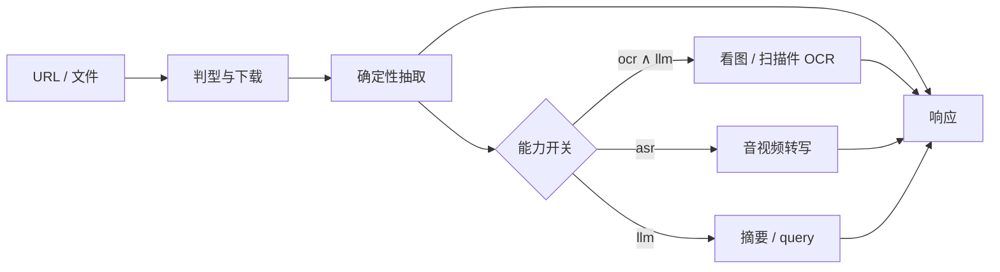

# anyurl2text

**把任意 URL 或本地文件，转成尽可能保留原始信息的文本或摘要。**

确定性抽取 · OCR 读图 · ASR 转写 · LLM 摘要

[项目介绍](#项目介绍) · [快速开始](#快速开始) · [怎么工作](#怎么工作) · [接口用法](#接口用法) · [项目结构](#项目结构)

---

## 项目介绍

网页、PDF、表格、截图、录音、视频——各自有合适的读法。只靠规则能抽出文档正文；要读图上的字、听清音视频里说了什么、再做摘要，就需要接上 OCR、ASR 和 LLM。

anyurl2text 用一条统一接口 `POST /convert` 完成这件事：先将URL或文件下载为临时文件，然后对临时文件根据文件的类型进行内容抽取，图片、视频等类型依赖额外的ASR、OCR服务进行增强抽取，文本内容总结依赖LLM服务

### 项目包含什么

| 能力 | 做什么 | 重要性 |
|---|---|---|
| 确定性抽取 | PDF / Office / 网页 / 表格等按格式出正文 | **核心**。只装后端依赖就能跑这一层 |
| OCR | 截图、扫描件、文档内嵌图读字 | **读图必需**。没有它，图片几乎只剩元信息 |
| ASR | 音视频转写成文字 | **听媒体必需**。没有它，只有时长等结构信息 |
| LLM | 摘要、按问题回答；看图时的判型与语义描述 | **理解与看图编排**。看图支路还须同时开 OCR |
| Web 界面 | 选源、开开关、看结果 | 本机调试与日常使用 |

远程仓库：https://github.com/moye233057/anyurl2text.git  
许可证：[MIT](LICENSE)  
仓库**不收录** OCR / ASR 模型权重，需自行下载到对应服务目录或准备其它相同类型的服务。

---

## 快速开始

命令默认在**仓库根目录**执行。

### Ⅰ 安装并跑通核心

需要：uv、Python ≥ 3.12（由 uv 管理）、Node.js ≥ 18。

**安装 uv**

```powershell
# Windows
powershell -ExecutionPolicy ByPass -c "irm https://astral.sh/uv/install.ps1 | iex"
```

```bash
# macOS / Linux
curl -LsSf https://astral.sh/uv/install.sh | sh
```

装完后新开终端，确认 `uv --version`、`node -v`。

**拿到代码并装依赖**

```powershell
git clone https://github.com/moye233057/anyurl2text.git
cd anyurl2text

copy .env.example .env   # macOS / Linux: cp .env.example .env

uv sync
cd frontend
npm install
cd ..
```

此时即可做**文档类确定性抽取**（扩展可暂不配）。一键拉起前后端：

```powershell
uv run python start.py
```

| 入口 | 地址 |
|---|---|
| 前端 | http://127.0.0.1:5173 |
| 接口文档 | http://127.0.0.1:8020/docs |
| 健康检查 | http://127.0.0.1:8020/probe/health |

也可分开起：
后端 `cd backend` 后 `uv run uvicorn app:app --host 127.0.0.1 --port 8020`；
前端 `cd frontend` 后 `npm run dev`。
端口与根目录 `.env` 里 `ANYURL2TEXT_PORT`（默认 `8020`）保持一致。Ctrl+C 停止 `start.py` 会一并收掉子进程。

### Ⅱ 配齐扩展（推荐）

核心能抽文档；要覆盖截图、扫描件、音视频和摘要，请把下面三项配上。它们需要额外步骤，却决定系统是否「完整」。

**1. LLM（摘要 / 看图判型）**

在根目录 `.env` 填写，例如 DeepSeek：

```env
DEEPSEEK_API_KEY=你的密钥
DEEPSEEK_BASE_URL=https://api.deepseek.com
DEEPSEEK_MODEL=deepseek-flash
```

本机 OpenAI 兼容服务把 `DEEPSEEK_BASE_URL` / `DEEPSEEK_MODEL` / `DEEPSEEK_API_KEY` 改成该服务即可（改完重启后端）。

**2. OCR（读图字）**

默认实现：`services/ocr/paddle-ocr`（端口 `8021`）。独立虚拟环境安装，勿装进仓库根 `.venv`：

```powershell
cd services/ocr/paddle-ocr
# 按该目录 requirements.txt 建环境并安装
python download_models.py    # 权重落到本目录 models/
python main.py               # 或由 start.py 在权重就绪时自动拉起
```

`.env` 默认：`OCR_API_URL=http://127.0.0.1:8021/ocr-b64`。

**3. ASR（音视频转写）**

默认实现：`services/asr/qwen3-asr`（端口 `8022`）。同样用独立环境：

```powershell
cd services/asr/qwen3-asr
# 建议 Python 3.12；有 GPU 时先装对应 CUDA 的 torch，再装 requirements.txt
python download_models.py
python main.py
```

`.env` 默认：`ASR_API_URL=http://127.0.0.1:8022/asr-b64`。

`start.py` 在 `START_SERVICES=true`（默认）且各服务 `models/` 里已有权重时，会尝试一并拉起 OCR / ASR。各服务细节见其目录下 README。

### Ⅲ 在界面里试一次

打开 http://127.0.0.1:5173 ：选 URL 或本地文件 → 按需勾选 OCR / ASR / LLM → 运行。  
文档类可先全关开关，确认正文；再开扩展做读图、转写或摘要。

---

## 怎么工作



- **先确定性，再增强。** 文档正文不依赖模型；扩展失败写进说明，不把失败包装成成功。
- **开关决定跑哪段。** 请求体里的 `ocr` / `asr` / `llm` 默认都是 `false`。
- **侧车与核心分离。** OCR / ASR 是独立进程，核心只通过本机 HTTP 送字节；权重在各自 `models/`，不进 git。

| 行为 | 需要打开的开关 |
|---|---|
| 图片判型、读字、语义描述；扫描件整页识别；文档内嵌图认字 | `ocr` **且** `llm` |
| 音视频转写 | `asr` |
| 摘要 / 按 query 回答 | `llm` |

---

## 接口用法

启动后交互文档：http://127.0.0.1:8020/docs 。

| 方法 | 路径 | 说明 |
|---|---|---|
| POST | `/convert` | JSON：`url` + `ocr` / `asr` / `llm`（可选 `query`） |
| POST | `/convert/file` | multipart 上传文件，字段同上 |
| GET | `/probe/health` | 自身与扩展是否就绪 |

示例（纯抽取，扩展全关）：

```bash
curl -s http://127.0.0.1:8020/convert \
  -H "Content-Type: application/json" \
  -d '{"url":"https://example.com/page.html","ocr":false,"asr":false,"llm":false}'
```

成功时响应固定七个字段：`type`、`content`、`summary`、`meta`、`usage`、`timings`、`error`。  
`content` 是交付正文；`summary` 仅在 LLM 实际跑过时可能非空；OCR / ASR 结果会并进 `content`，并在 `meta` 里留副本。

---

## 项目结构

```text
anyurl2text/
├── start.py                 # 一键拉起后端、前端；（条件）OCR / ASR
├── pyproject.toml           # 核心后端依赖（uv）
├── uv.lock
├── .env.example             # 复制为根目录 .env
├── services/                # 第三方侧车（独立环境与权重）
│   ├── ocr/paddle-ocr/      # 默认 OCR · 8021
│   └── asr/qwen3-asr/       # 默认 ASR · 8022
├── backend/
│   ├── app.py               # FastAPI 入口
│   ├── routers/             # /convert · /probe
│   ├── pipelines/           # 编排、步骤、各格式处理器
│   ├── extensions/          # 调用 OCR / ASR / LLM 的客户端
│   ├── configs/
│   ├── utils/
│   ├── tests/
│   └── scripts/
├── frontend/                # Web：单路 + 三开关
└── docs/                    # 内部说明（给协作与自动化用，日常使用不必读）
```
